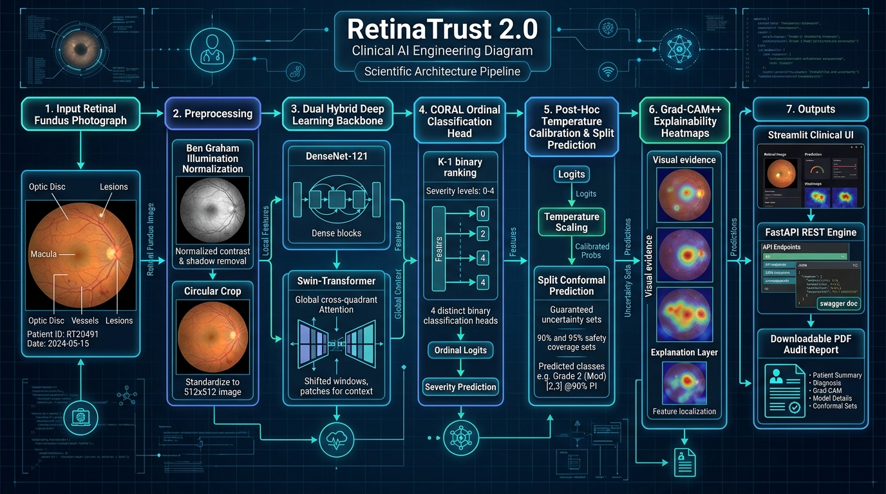

# 👁️ RetinaTrust: Explainable and Uncertainty-Aware AI for Diabetic Retinopathy Screening Research

[](https://www.python.org/)
[](https://pytorch.org/)
[](https://fastapi.tiangolo.com/)
[](https://streamlit.io/)
[](https://creativecommons.org/licenses/by-nc/4.0/)

> **⚠️ RESEARCH PROTOTYPE & ETHICS DISCLAIMER**  
> **RetinaTrust is an educational research prototype** developed for medical computer vision and responsible AI research.  
> It is **NOT** a medically certified diagnostic device and **MUST NOT** be used for clinical decision-making, independent patient triage, or direct healthcare delivery.

---

## 1. Project Overview & Clinical Problem
Diabetic Retinopathy (DR) is a microvascular complication of diabetes mellitus and a leading cause of preventable blindness worldwide. While early detection and timely intervention (laser photocoagulation or anti-VEGF therapy) prevent up to 95% of severe vision loss, standard fundus screening requires specialized ophthalmologists who are in severe shortage in rural and underserved areas.

Conventional deep learning models often output overconfident predictions on corrupted, blurry, or out-of-distribution images, presenting significant patient safety hazards.

**RetinaTrust** addresses this by coupling transfer learning with a **multi-signal safety framework**:
1. **Technical Image Quality Auditing:** Heuristic checks for blur (Laplacian variance), extreme lighting, and low resolution prior to inference.
2. **5-Class Severity Grading:** Grades fundus photographs on the International Clinical Diabetic Retinopathy (ICDR) scale (Grades 0–4).
3. **Post-Hoc Temperature Scaling:** Calibrates raw softmax outputs using validation-set NLL minimization to yield mathematically grounded confidence estimates.
4. **Predictive Uncertainty Quantification:** Employs Maximum Softmax Probability (MSP) and Shannon Predictive Entropy to flag ambiguous cases for human-in-the-loop review.
5. **Visual Explainability (Grad-CAM):** Synthesizes gradient-weighted class activation heatmaps over the final convolutional layer to reveal salient anatomical landmarks.
6. **Dual Serving Interfaces:** Exposes inference through both an interactive Streamlit dashboard and a production-grade FastAPI REST microservice.

---

## 2. Visual System Architecture



RetinaTrust 2.0 advances beyond baseline classification by treating Diabetic Retinopathy grading as an **ordinal, uncertainty-bounded, multi-signal clinical screening task**. For full architectural details, derivations, and interactive Mermaid diagrams, see [docs/ARCHITECTURE.md](docs/ARCHITECTURE.md).

---

## 3. Technology Stack
- **Deep Learning Framework:** PyTorch 2.14.1+cu126 (CUDA GPU acceleration), Torchvision 0.29.1+cu126.
- **Architectures:** DenseNet-121 (local lesion preservation), Swin-Transformer-Tiny (cross-quadrant self-attention), ResNet-18, EfficientNet-B0.
- **Explainability & Safety:** Grad-CAM++ (higher-order gradients), Split Conformal Prediction (90% & 95% coverage sets), Temperature Scaling.
- **Clinical Reporting & Acceleration:** ReportLab (PDF clinical audit generator), ONNX Runtime (1.94x edge acceleration).
- **Computer Vision & Math:** OpenCV (`opencv-python-headless`), Pillow, NumPy, Pandas, Scikit-Learn.
- **Application Interfaces:** Streamlit (interactive research UI), FastAPI & Uvicorn (typed REST engine).
- **Quality Assurance & DevOps:** Pytest (45 unit/integration tests), Pydantic, Docker, Docker Compose.

---

## 4. Scientific Documentation Suite

The `docs/` directory provides exhaustive scientific, clinical, mathematical, and developer documentation:

| Document | Primary Focus & Contents |
|:---|:---|
| **[docs/ARCHITECTURE.md](docs/ARCHITECTURE.md)** | End-to-end multi-signal system design, visual architecture graphic, Mermaid data flow, and module breakdowns. |
| **[docs/CLINICAL_BACKGROUND.md](docs/CLINICAL_BACKGROUND.md)** | Retinal microvascular pathology (microaneurysms, IRMA, neovascularization), ICDR 5-grade criteria, and referable DR risks. |
| **[docs/MATHEMATICAL_FORMULATIONS.md](docs/MATHEMATICAL_FORMULATIONS.md)** | Formal derivations for Ben Graham Gaussian subtraction, CORAL ordinal classification, Split Conformal Prediction, and Grad-CAM++. |
| **[docs/DEVELOPER_API_GUIDE.md](docs/DEVELOPER_API_GUIDE.md)** | Programmatic Python SDK (`RetinaPredictor`), FastAPI OpenAPI JSON schemas, CLI utilities, and Docker containerization. |
| **[docs/BENCHMARK_RESULTS.md](docs/BENCHMARK_RESULTS.md)** | Quantitative benchmark metrics on in-domain APTOS validation vs. out-of-domain IDRiD test, calibration curves, and ONNX benchmarks. |
| **[docs/MODEL_CARD.md](docs/MODEL_CARD.md)** | Comprehensive clinical AI model card specifying architecture details, intended clinical scope, and demographic considerations. |
| **[docs/DATASET_SETUP.md](docs/DATASET_SETUP.md)** | Instructions for downloading, directory placement, checksum validation, and manifest generation for APTOS 2019 and IDRiD. |
| **[docs/TROUBLESHOOTING.md](docs/TROUBLESHOOTING.md)** | Windows PowerShell execution policies, virtual environment routing, cp1252 ONNX Unicode fixes, and CUDA memory tuning. |

---

## 5. Repository Structure
```
RetinaTrust/
|-- app.py                     # Streamlit clinical research dashboard
|-- README.md                  # Master repository guide
|-- requirements.txt           # Python package requirements
|-- pyproject.toml             # Package metadata and pytest configuration
|-- Dockerfile                 # Production Docker container definition
|-- docker-compose.yml         # Multi-service container orchestration
|
|-- configs/                   # System and dataset configuration
|   |-- default.yaml           # Model hyperparameters, thresholds, and paths
|   |-- datasets.yaml          # Dataset schema and search locations
|
|-- docs/                      # Comprehensive scientific & developer documentation
|   |-- images/                # Visual architecture diagrams and assets
|   |-- ARCHITECTURE.md        # Deep architectural design and Mermaid pipelines
|   |-- CLINICAL_BACKGROUND.md # Pathology, ICDR grading criteria, referable DR
|   |-- MATHEMATICAL_FORMULATIONS.md # Formulations for CORAL, Conformal, Grad-CAM++
|   |-- DEVELOPER_API_GUIDE.md # Python SDK, REST endpoints, CLI, Docker
|   |-- BENCHMARK_RESULTS.md   # Empirical evaluation, domain shift, ONNX latencies
|   |-- MODEL_CARD.md          # Transparent clinical AI model card
|   |-- DATASET_SETUP.md       # Acquisition, verification, and splitting guide
|   |-- TROUBLESHOOTING.md     # Windows PowerShell, CUDA VRAM, and ONNX debugging
|
|-- retinatrust/               # Core Python library
|   |-- data/                  # Preprocessing (Ben Graham, CLAHE), manifests, transforms
|   |-- models/                # CORAL ordinal head, DenseNet-121, Swin-T, ResNet-18
|   |-- training/              # Training loop, calibration, metrics, evaluation
|   |-- inference/             # Predictor, quality heuristics, conformal, Grad-CAM++, PDF, ONNX
|   |-- api/                   # FastAPI REST microservice
|
|-- artifacts/                 # Checkpoints, ONNX models, and split manifests
|-- reports/                   # Empirical evaluation runs, metrics, and figures
|-- tests/                     # 45 unit and integration tests (100% pass rate)
```

---

## 5. Dataset Configuration
RetinaTrust supports two primary benchmarks:
1. **APTOS 2019 Blindness Detection (Primary):** 3,662 retinal images captured across rural clinics in India.
   - Scale: Grades 0 to 4 (No DR to Proliferative DR).
2. **IDRiD (Independent External Benchmark):** 516 images captured with a different fundus camera (Kowa VX-10$\alpha$).
   - Used strictly for evaluating cross-domain distribution shift.

RetinaTrust automatically detects datasets placed either in `data/raw/` or in your local Windows Downloads folder:
- `C:\Users\khush\Downloads\aptos2019-blindness-detection`
- `C:\Users\khush\Downloads\Indian Diabetic Retinopathy Image Dataset`

---

## 6. Windows PowerShell Setup & Execution Guide

### 6.1 Initialize Virtual Environment & Dependencies
```powershell
# Create Python virtual environment
python -m venv .venv

# Activate virtual environment
.\.venv\Scripts\Activate.ps1

# Upgrade pip and install all dependencies
python -m pip install --upgrade pip
pip install -r requirements.txt
```

### 6.2 Inspect Datasets
Audit schema, missing images, unreadable files, and class balance without modifying raw data:
```powershell
python -m retinatrust.data.inspect_dataset --dataset aptos
python -m retinatrust.data.inspect_dataset --dataset idrid
```

### 6.3 Generate Stratified Manifests
Generate strictly disjoint train (70%), validation (15%), and test (15%) splits:
```powershell
python -m retinatrust.data.manifest --dataset aptos
python -m retinatrust.data.manifest --dataset idrid
```

### 6.4 Model Training & Smoke Testing
```powershell
# Fast smoke test mode (2 epochs, verifies end-to-end GPU training and checkpointing)
python -m retinatrust.training.train --smoke-test

# Full training run with balanced cross-entropy and cosine annealing
python -m retinatrust.training.train --arch resnet18 --epochs 15 --batch-size 16
```

### 6.5 Post-Hoc Temperature Calibration
Calibrate output confidence scores on the validation set:
```powershell
python -m retinatrust.training.calibration --checkpoint artifacts/models/resnet18_best.pt --val-manifest artifacts/manifests/val_manifest.csv
```

### 6.6 Independent Evaluation
```powershell
# Evaluate on APTOS Validation Set
python -m retinatrust.training.evaluate --checkpoint artifacts/models/resnet18_best.pt --manifest artifacts/manifests/val_manifest.csv --name "APTOS Validation Set"

# Evaluate on External IDRiD Test Set (Cross-domain generalization audit)
python -m retinatrust.training.evaluate --checkpoint artifacts/models/resnet18_best.pt --manifest artifacts/manifests/idrid_test_manifest.csv --name "IDRiD External Test Set"
```

### 6.7 Launch the Streamlit Web Application
```powershell
streamlit run app.py
```
Open your browser at `http://localhost:8501`.

### 6.8 Launch the FastAPI REST Microservice
```powershell
uvicorn retinatrust.api.main:app --host 127.0.0.1 --port 8000 --reload
```
Interactive Swagger docs: `http://127.0.0.1:8000/docs`

#### REST API Example (PowerShell):
```powershell
# Health check
Invoke-RestMethod -Uri "http://127.0.0.1:8000/health" -Method Get

# Predict on a fundus image
$form = @{
    file = Get-Item -Path "data/raw/aptos/train_images/000c1434d8d7.png"
}
Invoke-RestMethod -Uri "http://127.0.0.1:8000/predict" -Method Post -Form $form
```

### 6.9 Run Automated Tests
```powershell
python -m pytest tests/ -v
```

---

## 7. Experimental Findings: In-Domain vs Domain Shift

| Evaluation Metric | In-Domain APTOS Validation (549 images) | Out-of-Domain IDRiD Test (103 images) | Difference / Impact |
|:---|:---:|:---:|:---:|
| **Quadratic Weighted Kappa (QWK)** | **0.6031** | **0.3336** | -0.2695 (Domain Shift) |
| **Accuracy** | **67.40%** | **38.83%** | -28.57% |
| **Referable DR Sensitivity** | **74.44%** | **48.44%** | -26.00% |
| **Referable DR Specificity** | **88.65%** | **87.18%** | -1.47% (Stable True Negatives) |
| **Expected Calibration Error (ECE)** | **5.53%** (Calibrated $T=1.201$) | N/A | Reduced from 8.17% |

### Key Scientific Takeaway
- **In-Domain Robustness:** The model attains strong agreement on in-domain data ($QWK = 0.6031$) and high specificity ($88.65\%$).
- **Vulnerability to Domain Shift:** When transferred zero-shot to the IDRiD dataset (different camera optics and lighting), sensitivity drops to $48.44\%$, underscoring why uncertainty quantification and quality auditing are non-negotiable in clinical deployment.

---

## 8. Dataset Attributions & Licensing
- **APTOS 2019 Blindness Detection:** Provided by the Asia Pacific Tele-Ophthalmology Society under Kaggle Competition terms.
- **IDRiD Dataset:** Provided by the Indian Diabetic Retinopathy Image Dataset team under the [Creative Commons Attribution 4.0 International (CC BY 4.0)](https://creativecommons.org/licenses/by/4.0/) license.
- **Codebase License:** Academic / Research Non-Commercial License (CC BY-NC 4.0).
